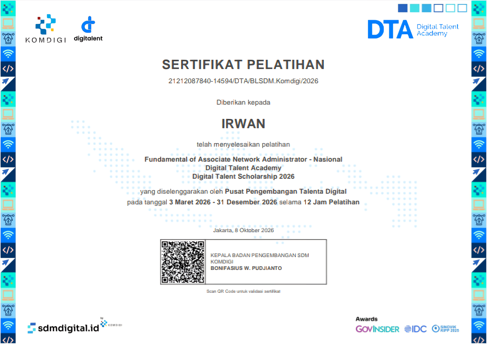
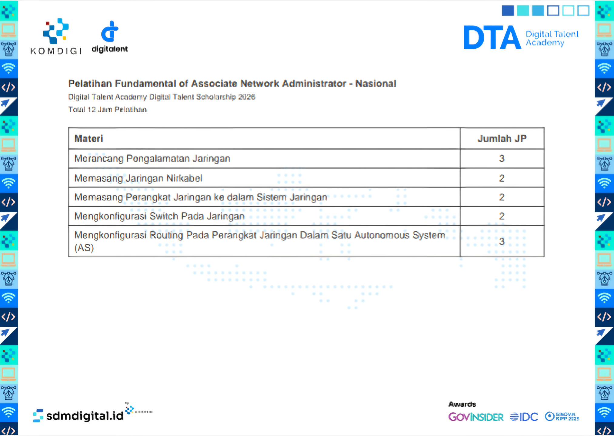
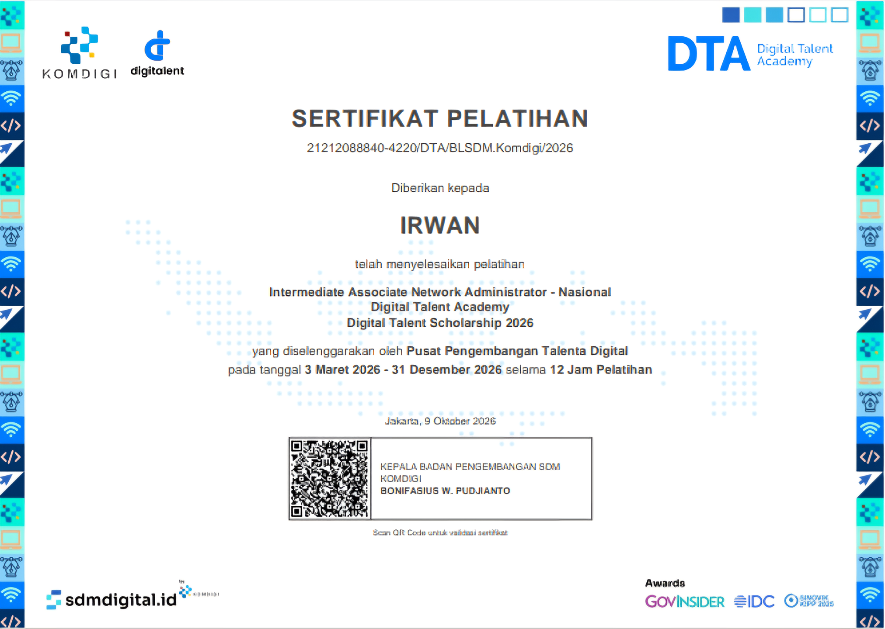
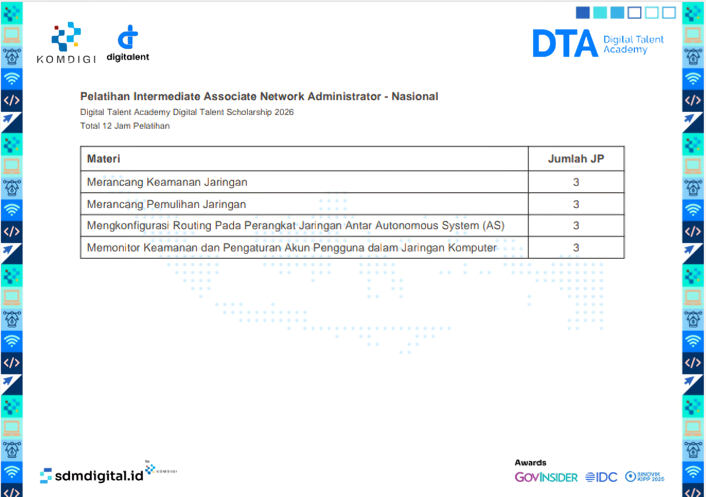

# Sertifikat & Pencapaian

Kumpulan sertifikat pelatihan dan pencapaian saya di bidang keamanan siber dan administrasi jaringan.

## Daftar Sertifikat

| No | Nama Sertifikat | Penerbit | Tahun |
|---|---|---|---|
| 1 | Fundamental of Associate Network Administrator - Nasional | DTS Komdigi | 2026 |
| 2 | Intermediate Associate Network Administrator - Nasional | DTS Komdigi | 2026 |

## Detail Sertifikat

### 1. Fundamental of Associate Network Administrator - Nasional (DTS Komdigi)

- **Penerbit**: Pusat Pengembangan Talenta Digital
- **Durasi**: 12 Jam Pelatihan
- **Materi**: Merancang pengalamatan jaringan, konfigurasi switch, routing OSPF/RIP, jaringan nirkabel.

**Sertifikat:**

**Transkrip Materi:**

### 2. Intermediate Associate Network Administrator - Nasional (DTS Komdigi)

- **Penerbit**: Pusat Pengembangan Talenta Digital
- **Durasi**: 12 Jam Pelatihan
- **Materi**: Merancang Keamanan Jaringan, Merancang Pemulihan Jaringan, Mengkonfigurasi Routing Pada Perangkat Jaringan Antar Autonomous System (AS), Memonitor Keamanan dan Pengaturan Akun Pengguna dalam Jaringan Komputer.

**Sertifikat:**

**Transkrip Materi:**

